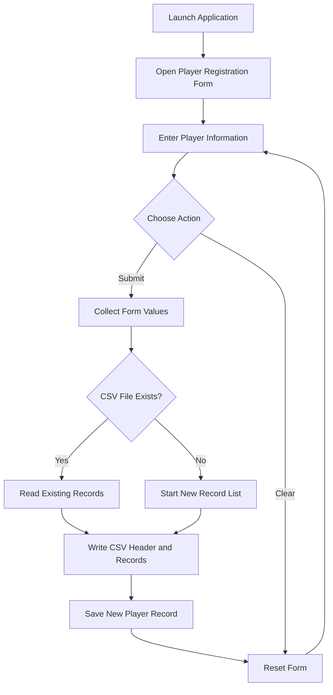

<div align="center">

# 🏀 Basketball Player Registry

**A Java Swing desktop application for recording and managing basketball player information through an interactive graphical user interface.**


*Java Swing · Event-Driven Programming · File I/O · GUI Development · CSV Data Management*

</div>

---

## Overview

**Basketball Player Registry** is a Java desktop application designed to simplify the collection and storage of basketball player information.

The application provides an interactive graphical user interface (GUI) where users can register players by entering personal details, contract information, salary ranges, playing positions, and age.

Player records are saved to a CSV file, allowing information to persist between application sessions and be accessed through spreadsheet applications such as Microsoft Excel.

The project demonstrates Java Swing components, event-driven programming, file handling, and graphical interface design using `GridBagLayout`.

## Features

| | Feature | Implementation |
|:---:|---|---|
| 🖥️ | **Graphical user interface** | Interactive desktop form developed using Java Swing. |
| 👤 | **Player registration** | Collects player first name, last name, and age. |
| 🏀 | **Position selection** | Dropdown menu supporting PG, SG, SF, PF, and C. |
| 💰 | **Salary classification** | Radio buttons for four annual salary ranges. |
| 📋 | **Contract tracking** | Checkbox identifying whether a player has a rookie contract. |
| 📤 | **CSV data export** | Saves submitted player information into `basketballDatabase.csv`. |
| 🔄 | **Persistent records** | Reads existing CSV records and preserves them when saving additional players. |
| 🧹 | **Form reset** | Clears form fields after submission or when the Clear button is pressed. |

### Player Information Fields

| Field | Component | Available values |
|---|---|---|
| First Name | `JTextField` | Text input |
| Last Name | `JTextField` | Text input |
| Rookie Contract | `JCheckBox` | Yes / No |
| Annual Salary | `JRadioButton` | Four salary ranges |
| Position | `JComboBox` | PG, SG, SF, PF, C |
| Age | `JSpinner` | 18–100 |
| Submit | `JButton` | Save record and reset form |
| Clear | `JButton` | Reset form without saving |

### Salary Ranges

The application supports the following annual salary categories:

- Less than $500,000
- $500,000 – $5 million
- $5 million – $25 million
- Greater than $25 million

Only one salary category can be selected at a time through a `ButtonGroup`.

## Application Workflow



### Submission Process

1. The user enters a player's information through the GUI.
2. The application retrieves the values from the corresponding Swing components.
3. If `basketballDatabase.csv` already exists, the application reads its existing player records.
4. A `PrintWriter` writes the CSV header, existing records, and the newly submitted record.
5. The form resets to its default state, ready for another entry.

The application supports registering multiple players during a single session.

### Java Classes

**`BasketballPlayerRegistry.java`**

Contains the application's `main()` method, which initializes the registration form, configures the window, and launches the GUI.

**`PlayerRegistryForm.java`**

Extends `JFrame` and handles the application's main functionality:

- Creates and organizes Swing GUI components.
- Processes Submit and Clear button events.
- Retrieves player information from input fields.
- Reads existing records using `Scanner`.
- Writes player records using `PrintWriter`.
- Resets input fields to their default values.

The class uses an inner `ActionListener` implementation to process button interactions.

## Getting Started

### Requirements

- Java Development Kit (JDK 8 or later)
- Eclipse IDE or another Java-compatible development environment
- No external libraries required

### Run with Eclipse

1. Create a new Java project in Eclipse.
2. Add `BasketballPlayerRegistry.java` and `PlayerRegistryForm.java` to the project's `src` folder.
3. Ensure both classes are in the same package.
4. Right-click `BasketballPlayerRegistry.java`.
5. Select **Run As → Java Application**.
6. The basketball player registration window will open.

### Run from the Terminal

Place both `.java` files in the same directory.

Compile the application:

```bash
javac BasketballPlayerRegistry.java PlayerRegistryForm.java
```

Launch the application:

```bash
java BasketballPlayerRegistry
```

The graphical interface will open automatically.

## CSV Data Storage

The application creates or updates a file named:

```text
basketballDatabase.csv
```

The file contains six columns:

```csv
First Name,Last Name,Rookie Contract,Salary(per year),Position,Age
```

### Example Output

The following example illustrates the format of the generated CSV data:

```csv
First Name,Last Name,Rookie Contract,Salary(per year),Position,Age
Michael,Jordan,No,>$25m,SG,35
Stephen,Curry,No,>$25m,PG,36
Victor,Wembanyama,Yes,$5m - $25m,C,21
```

*These are illustrative records rather than an included dataset.*

### Data Persistence

When the user selects **Submit**, the program:

1. Checks whether `basketballDatabase.csv` exists.
2. Reads the existing records if the file is available.
3. Stores the previous records temporarily in an `ArrayList<String>`.
4. Rewrites the file with its header, previous records, and the new player information.

This preserves previously saved records instead of replacing them with only the latest submission.

The CSV file is generated in the application's working directory.

## Form Behavior

### Submit Button

- Collects all current player information.
- Writes the record to the CSV file.
- Preserves existing records when the file is readable.
- Resets the form for the next player.

### Clear Button

Resets all input components without submitting a record:

- First and last name fields become empty.
- Rookie contract checkbox becomes unchecked.
- Salary radio button selection is cleared.
- Position dropdown returns to `PG`.
- Age spinner returns to `18`.

## Technical Implementation

| Concept | Implementation |
|---|---|
| GUI framework | Java Swing |
| Window management | `JFrame` |
| Layout management | `GridBagLayout` and `GridBagConstraints` |
| Event handling | `ActionListener` |
| Component handling | Swing controls and event-source checks |
| File reading | `File` and `Scanner` |
| File writing | `PrintWriter` |
| Temporary storage | `ArrayList<String>` |
| Output format | CSV |

### Event-Driven Programming

The application responds to user interactions through an `ActionListener`.

When either button is clicked, the corresponding event handler determines whether the user requested submission or form clearing.

This separates the interface's interactive behavior from the application's startup process.

## Current Limitations

The application is a functional desktop registration tool with several opportunities for improvement:

- **Limited input validation:** Empty names and unselected salary ranges are not prevented.
- **Basic CSV handling:** Text containing commas or other special CSV characters is not escaped.
- **File I/O error handling:** File access errors are reported to the console rather than through GUI notifications.
- **No record editing or deletion:** Saved player records cannot be modified or removed through the interface.
- **No player search:** Existing records are stored in CSV but are not displayed in a searchable interface.
- **Full-file rewriting:** Each submission reloads existing records and rewrites the CSV rather than appending directly.

## Possible Enhancements

Future development could include:

- Input validation with GUI error messages.
- A searchable table of registered players using `JTable`.
- Editing and deleting existing player records.
- More robust CSV processing.
- Player statistics and summaries by position, salary range, or contract type.
- Database integration for larger datasets.
